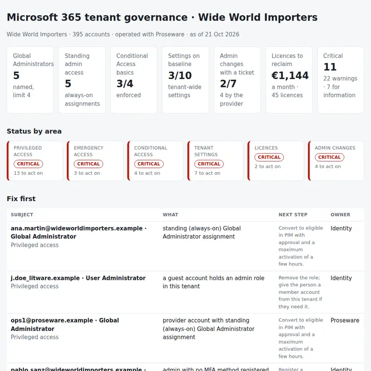

# M365 Tenant Governance Review

A monthly review of a Microsoft 365 tenant from a read-only export: who holds admin roles and how, whether the emergency accounts would work, whether the Conditional Access basics are on, which tenant settings drifted from the baseline, which licences are paid for nothing, and which admin changes were made without an approved change. One PowerShell export, one Python command, and the answer to: **is the tenant still governed the way we agreed, including the changes the provider makes for us?**

Python 3.10+, standard library only, plus a read-only PowerShell exporter (Microsoft Graph and, optionally, Exchange Online). Runs with fictional demo data out of the box.



## Why

A tenant drifts one reasonable change at a time:

- a **Global Administrator** given "just for the migration" is still always-on two years later;
- the **provider's** engineers hold permanent admin roles with no end date, and one of them adds a colleague as SharePoint Administrator on a Wednesday night with no change ticket;
- the change to allow **automatic forwarding** was rejected at CAB, and it was made anyway;
- the **legacy authentication** block has been in report-only since July;
- the second **emergency account** is only eligible in PIM, so it cannot help on the day PIM or MFA fail;
- ten **leavers** still have an E3 licence, and Power BI is three seats over what was bought.

When the platform is operated by a managed service provider, the internal team still owns the risk. This tool turns the export into a short list for the monthly governance review and for the service review with the provider.

## What it checks

| Area | Checks |
|---|---|
| Privileged access | Too many or too few Global Administrators (emergency accounts not counted). Standing (permanent) tier 0 roles (critical) and other admin roles. Guests with admin roles (critical). Admins without MFA (critical). Disabled or stale admins. Provider assignments with no end date. Applications holding tier 0 roles. Expired assignments still listed. |
| Emergency access | Fewer than two emergency accounts, missing or disabled accounts, accounts that are not permanent Global Administrators, recent sign-ins, and Conditional Access policies that could lock them out. |
| Conditional Access | The four basics: legacy authentication blocked, MFA for admins, MFA for all users, MFA for guests. Policies left in report-only for more than 30 days, switched-off policies, and exclusions other than the emergency accounts. |
| Tenant settings | Ten settings against a baseline: user consent, guest invitations, app registration and tenant creation, SharePoint "Anyone" links, automatic forwarding, SMTP AUTH, DKIM, mailbox auditing and the unified audit log. |
| Licences | Licences on disabled accounts and on accounts with no sign-in for 90 days, with the monthly cost; more licences assigned than bought; spare seats. |
| Admin changes | Each sensitive admin action (roles, Conditional Access, tenant and mail-flow settings) matched to a change ticket by implementer and window: approved, emergency, rejected, no ticket, or made with an emergency account. A provider change with no ticket is critical. |

Outputs:

- `report.html`: single file, light and dark mode. It has:
  - the headline numbers and the status by area;
  - what to fix first;
  - every privileged assignment with its issues;
  - the Conditional Access basics and the policy list;
  - the settings baseline, licence use, and the admin changes with their tickets.
- `review.md`: Fix first / This month / For the service review with the provider.
- `actions.csv`: one row per action, worst first, with the owner (internal team or provider) and a `done` column.
- `privileged-access.csv`: the list for the quarterly access review, with `keep_yes_no` and `reviewer` columns.
- `licence-reclaim.csv`: licences to reclaim, with the reason and the monthly cost.
- `admin-changes.csv`: sensitive admin actions and the change that covers each one.
- `findings.csv`.

How to run the monthly review, with or without a provider: [docs/governance-runbook.md](docs/governance-runbook.md). File format and baseline: [docs/data-format.md](docs/data-format.md).

## Try it

```bash
git clone https://github.com/inigogonzalezgarcia/27-m365-tenant-governance-review.git
cd 27-m365-tenant-governance-review
python -m tenantgov demo
```

Open `output/report.html` and `output/review.md`.

### The demo data

The demo is a made-up retailer: Wide World Importers, with a head office and shops, reviewed on 21 October 2026. The tenant is operated day to day by a fictional managed service provider, Proseware. It has 395 accounts, 18 role assignments, 5 Conditional Access policies, 4 licence types and a month of admin activity with 4 change tickets. Names, prices and events are invented.

The problems are placed on purpose:

- **Privileged access:**
  - 5 named Global Administrators;
  - always-on Global Administrator for an internal admin and for a provider engineer;
  - a guest consultant as User Administrator, an admin with no MFA, a stale one and a disabled one;
  - provider roles with no end date, and an HR provisioning app with Global Administrator.
- **Emergency access:** the second emergency account is only eligible, is not excluded from the MFA policy, and the first one was used 12 days ago.
- **Conditional Access:** the legacy authentication block is in report-only since July; the MFA policy has two extra exclusions.
- **Settings:** users can consent to any app, everyone can invite guests and create tenants, Anyone links are on, automatic forwarding is on, SMTP AUTH is on and one domain has no DKIM.
- **Licences:** 10 E3 licences on disabled accounts, 35 unused for 90+ days, and Power BI three seats over.
- **Admin changes:**
  - a provider role assignment at 23:40 with no ticket;
  - the forwarding change made inside the window of a rejected change;
  - a Conditional Access edit made with an emergency account;
  - an internal change with no ticket, and one emergency change.

## Use it with your own tenant

1. Export the tenant with a Global Reader account:
   ```powershell
   Install-Module Microsoft.Graph.Authentication, ExchangeOnlineManagement -Scope CurrentUser
   .\scripts\Export-TenantGovernance.ps1 -OutputPath .\data\tenant.json -IncludeExchange -Days 31
   ```
   - It is read-only. The Graph scopes are listed at the top of the script.
   - Sign-in activity and the MFA report need Entra ID P1; PIM eligible roles need P2.
2. Export the month's change tickets to `data/changes.csv` (reference, status, implementer, window).
3. Optionally add `data/settings.json` with the provider's domains, the emergency accounts and your licence prices.
4. Build the outputs:
   ```bash
   python -m tenantgov report data/ --title "M365 governance · October"
   ```
   Options:
   - `--as-of 2026-10-31` sets the review date;
   - `--max-global-admins 4`, `--stale-days 90` and `--report-only-days 30` change the thresholds.

The export describes how your tenant is protected. Keep it inside your organisation:

- real files at the top level (`tenant*.json`, `changes*.csv`, `data/`) and the `output/` folder are excluded from Git by `.gitignore`;
- only the fictional files in `sample_data/` are committed;
- the exporter reads names, dates and settings; it never reads mail, files or secrets.

## Tests

```bash
python -m unittest discover tests      # or: pip install -r requirements-dev.txt && python -m pytest
```

There are 16 tests:

- **Parsing:** dates in ISO and Spanish formats, role aliases, a semicolon change file with a BOM and Spanish headers, and a snapshot with Graph field names and setting overrides.
- **Clean tenant:** a well-governed tenant with no findings, all CA basics and the full baseline.
- **Privileged access:**
  - standing tier 0 against other admin roles, and reader roles ignored;
  - the Global Administrator count without the emergency accounts, and the threshold option;
  - per-person checks grouped per account (no MFA, stale, disabled, guest, unknown);
  - provider assignments without an end date, expired assignments and apps with tier 0 roles.
- **Emergency access:** missing, not permanent, recent sign-in, not excluded, a phishing-resistant policy that may include them, and an emergency group as the exclusion.
- **Conditional Access:** missing basics with a report-only policy, report-only age, switched-off policies and extra exclusions.
- **Settings:** drift by severity, a missing setting, and case-insensitive values.
- **Licences:** disabled and inactive accounts, a new account not flagged, over-assignment, spare seats and the monthly total.
- **Admin changes:** matching by provider name, domain and UPN, the grace after the window, rejected and emergency changes, emergency accounts, and severity for provider and internal changes.
- **Demo end to end:** every check fires, all seven outputs are written, and guest addresses are shortened in the report.

**Next steps for your tenant:**

- run the exporter with a Global Reader account against your tenant and check the role names and the Conditional Access mapping on the first run;
- agree the baseline in `tenantgov/checks.py` with security before the first review;
- ask the provider to put the change reference in every admin session, so the change matching becomes a formality.

## Background

Built from my work running Microsoft 365 in IT operations, including:

- Global Administrator of Microsoft 365, with PIM and just-in-time access for admin roles;
- Conditional Access, app integration in Entra ID with SAML, SSO and app registrations;
- Exchange Online administration, and Microsoft Purview DLP and sensitivity labels;
- Microsoft 365 tenant-to-tenant migrations;
- change management through CAB, and working with providers and offshore teams under SLAs.

Written from scratch with fictional data; no employer data, tenant settings or audit logs are used.

## Customisation and contact

Want this adapted to your tenant? For example:

- your own baseline (CIS, ENS or your security policy);
- reading the change tickets straight from ServiceNow or Jira;
- adding Teams, Intune or Defender settings;
- a quarterly access review sent to each role owner.

Get in touch:

- Website (contact form): [inigogonzalezgarcia.github.io](https://inigogonzalezgarcia.github.io/about.html#contacto)
- LinkedIn: [linkedin.com/in/igonzalez93](https://www.linkedin.com/in/igonzalez93)

## License

MIT
